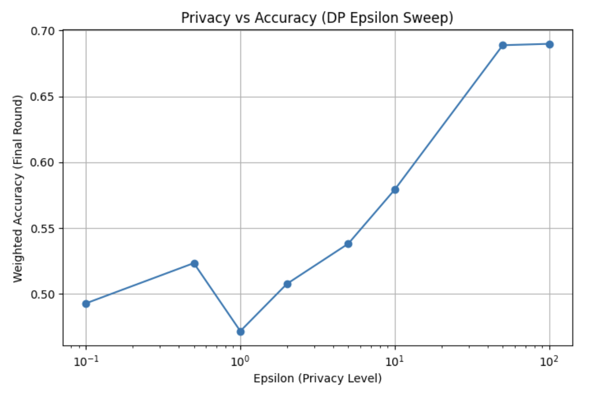
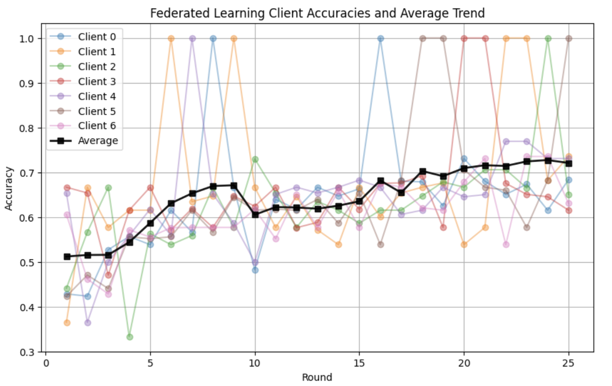

# Differential Privacy in Federated Learning on MIMIC-IV

This project trains an in-hospital mortality model across simulated hospital "clients" without pooling patient data. It then measures how much accuracy is lost when **differential privacy** noise is added to each client's updates.

This was a team project for MA 591 (April 2025) by Shrawani Gulhane, Gaurav Mehta and Vasudev Menon. The full write-up is in [`Final_Report.pdf`](Final_Report.pdf).

## Results

| Setup | Final-round accuracy |
| --- | --- |
| Centralized neural network (no federation) | 68.6% |
| Federated, 5 clients with random splits, no privacy | 68.4% |
| Federated, 7 clients split by demographic group, no privacy (baseline run in the sweep notebook) | 68.4% |
| Same 7 clients with local differential privacy, ε = 0.1 to 2 | 47–52% |
| Same 7 clients with local differential privacy, ε = 10 | 57.9% |
| Same 7 clients with local differential privacy, ε = 50 to 100 | 68.9–69.0% |

**Main finding:** strong privacy (small ε) pushes the model to chance level on this task. At ε ≥ 50 it matches the non-private model. Accuracy is weighted by each client's number of validation examples. The task is a balanced binary prediction, so 50% is chance.





## Approach

1. **Data:** from MIMIC-IV (see [`data/Data.txt`](data/Data.txt)), we took the patient-level mean of six vital signs: diastolic and systolic blood pressure, glucose, heart rate, respiratory rate and temperature. The label is whether the patient died in hospital.
2. **Cleaning:**
   - Removed values below the 1st and above the 99th percentile.
   - Dropped rows with missing values.
   - Undersampled the majority class. Only about 9% of patients died, and undersampling produced a balanced set of 4,726 patients.
3. **Model:** a small PyTorch network (6 → 4 → 2 → 1) trained with Adam and binary cross-entropy.
4. **Federation:** a [Flower](https://flower.ai/) simulation using FedAvg over 25 rounds, with 10 local epochs per round.
   - Clients were split either randomly (5 clients) or by grouped race (7 clients of very different sizes), to imitate hospitals with different patient populations.
5. **Privacy:** Flower's `LocalDpMod` clips each client's update (clipping norm 5.0) and adds noise. We swept ε from 0.1 to 100 with δ = 1e-5.
   - An earlier experiment (`ddp.ipynb`) used Opacus DP-SGD with a noise multiplier of 0.5.

## Repository contents

| Path | What it is |
| --- | --- |
| `Notebooks/federated_learning.ipynb` | Federated learning with 5 random clients, no privacy |
| `Notebooks/federated_learning_race_split.ipynb` | Federated learning with 7 clients split by demographic group |
| `Notebooks/ddp_federated_learning_DemographicGroup_split.ipynb` | The privacy budget sweep shown above |
| `Notebooks/ddp.ipynb` | Opacus DP-SGD experiment |
| `Notebooks/model_tuning.ipynb` | Centralized baseline |
| `scripts/` | MIMIC-IV extraction and cleaning |
| `src/` | An early standalone Flower client and server. The notebooks are the final version. |

## Run it

1. Get credentialed access to MIMIC-IV on PhysioNet and build the merged CSV files (see [`data/Data.txt`](data/Data.txt)).
2. Open a notebook in Google Colab. A GPU is optional.
3. Set `DEFAULT_PATH` to the folder that holds the CSV files.
4. Run all cells.

To run the notebooks locally, install the dependencies first:
```bash
pip install -r requirements.txt
```

No patient data is included in this repository.

## Limitations

- Each run uses a single random seed. The small clients' accuracy swings a lot from round to round.
- The model is deliberately small and uses only six features, so absolute accuracy is modest. The point of the project is the privacy/accuracy trade-off, not the best mortality model.
